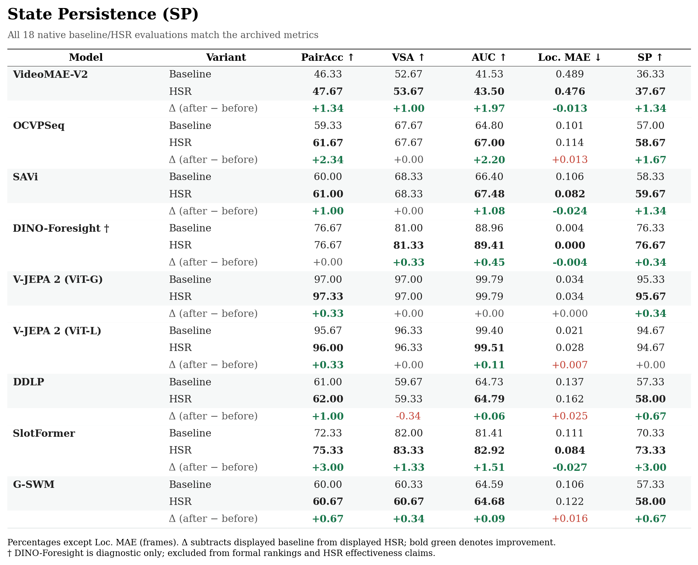
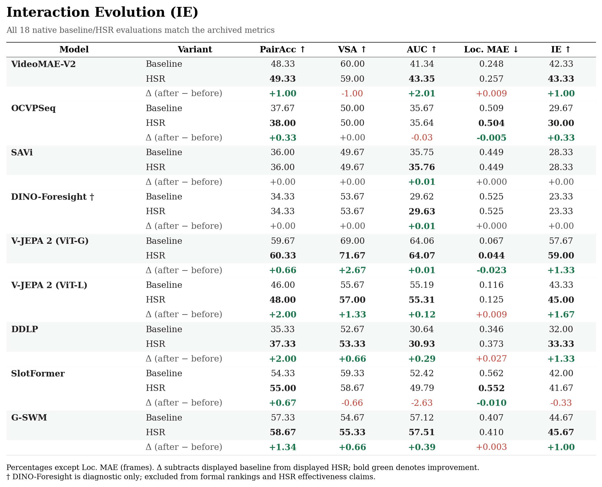

# HSR

Historical State Rectification for predictive world models.

SP and IE each contain 300 pairs. Evaluation uses eight observed frames and six future frames; see [protocol and model details](EVALUATION.md).

## Setup

Tested on one **RTX 4060 Ti (16 GB)**, an Intel i5-12600KF and 32 GB RAM. See [ENVIRONMENTS.md](ENVIRONMENTS.md) for the Python, PyTorch, CUDA and installation settings.

Download the original data from [Releases](https://github.com/0neDawn/HSR/releases/tag/v1.0.0) and obtain the checkpoints listed in [ASSETS.md](ASSETS.md).

## Run

After setting up the environments and checkpoints:

```bash
python scripts/restore_assets.py /path/to/downloads --only data_sp data_ie
python scripts/fetch_ocvp.py
bash reproduce.sh --mode full --wait-for-resources
```

This runs all baseline and HSR evaluations sequentially. Results are saved to `runs/full_reproduction/`; rerunning the command resumes interrupted runs.

To recompute the tables from saved errors without model inference:

```bash
python -m pip install -r requirements-metrics.txt
bash reproduce.sh --mode verify
```

## Results




PDF: [SP](results/figures/SP_results.pdf) · [IE](results/figures/IE_results.pdf).

Settings were selected on the evaluation pairs without a held-out selection set. DINO-Foresight (†) is diagnostic only; see [evaluation notes](EVALUATION.md).

[Configurations](configs/final_configs.json) · [Validation](VALIDATION.md) · [Third-party licenses](THIRD_PARTY.md).
